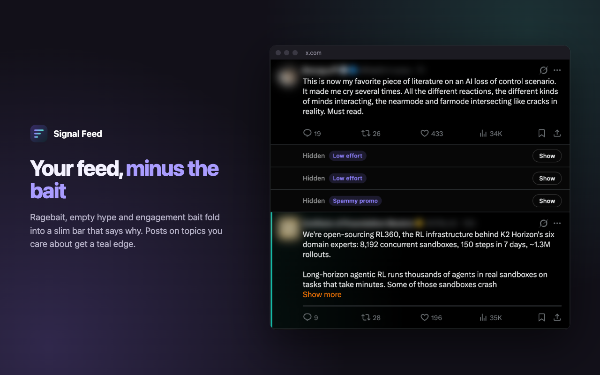
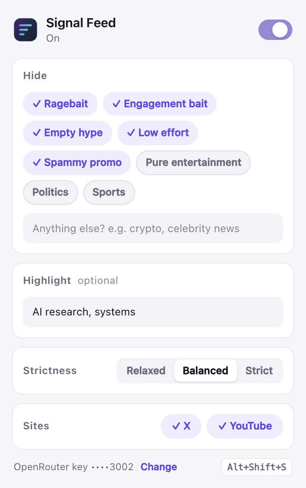

<p align="center"></p>
<h1 align="center">Signal Feed</h1>
<p align="center">Your X and YouTube feeds, minus the bait. Ragebait, empty hype and engagement bait fold away before you scroll to them, each with the reason why.</p>
<p align="center"><a href="https://github.com/harish-anumula/signal-feed/actions/workflows/ci.yml"></a> <a href="LICENSE"></a></p>

<p align="center"></p>

## What it does

- **Folds feed noise, and says why.** Posts that match your hide list collapse to a slim bar with the reason ("Ragebait", "Engagement bait", …). On YouTube, cards keep their place so the grid doesn't jump.
- **Undo is one click.** Show opens a post; Hide again folds it back. Always show @handle (or a YouTube channel) keeps people you trust out of it for good. Show all opens everything on the page from the toolbar popup.
- **Highlights what you came for.** Type a few topics ("AI research, climbing") and matching posts get a teal edge.
- **Decides ahead of you.** Posts are checked in batches about two screens before you reach them.
- **One key, three choices.** Paste an OpenRouter key, then pick what to hide (chips plus your own words), what to highlight, and Relaxed, Balanced or Strict.
- **Shows what it costs.** The popup has a 7-day spend chart, today's count, the total and the most common reasons, from the cost OpenRouter reports for each request.
- **Alt+Shift+S** turns it on or off from any tab. The toolbar badge counts the hidden posts on the page.
- **Fails open.** If OpenRouter is down or the key runs out, your feed is shown as it is and the badge shows `!`.

Works on the X timeline, profiles and threads (never the post you opened), the YouTube home page and the sidebar next to a video.

## Install

**Chrome Web Store:** coming soon.

**From source:**

1. Download this repository (or the zip from the latest release) and unzip it.
2. Open `chrome://extensions`, turn on **Developer mode**, click **Load unpacked**, and choose the `extension` folder.
3. A welcome tab opens. Paste an [OpenRouter API key](https://openrouter.ai/keys) and click **Connect**.
4. Open X or YouTube.

Works in Chrome, Edge, Brave and other Chromium browsers.

## How well it works

Measured on a real X feed with the default hide list (details and method in [eval/](eval/README.md)):

| Strictness | Of the posts it hides, wanted hidden | Of the posts you'd hide, caught | Good posts hidden by mistake |
|---|---|---|---|
| Relaxed | 100% | 70% | 0% |
| **Balanced** (default) | **96%** | **85%** | **3%** |
| Strict | 79% | 96% | 19% |

The reason on a folded post matches the hand label 36 of 38 times on X and 18 of 20 on YouTube.

## Cost and speed

Signal Feed uses your own OpenRouter key to call [Jev](https://openrouter.ai/typesafe/jev-1.13), TypeSafe's fast judgment model, which answers with a probability rather than text. Each post gets one yes-or-no question ("should this be hidden under your hide list?"), one more if you set topics to highlight, and hidden posts get a short follow-up for the reason.

| | Per 1,000 posts | Per batch of 20 |
|---|---|---|
| Hide (default) | about $0.02 | about 0.5 s |
| Hide and highlight | about $0.03 | about 0.5 s |

Measured with `node eval/run.mjs` on 23 Oct 2026. Answers are cached for the browser session, so scrolling back up costs nothing. The popup shows exactly what you've spent.

## Settings



| Setting | What it does |
|---|---|
| **Hide** | Chips for common noise (on by default: ragebait, engagement bait, empty hype, low effort, spammy promo; off: pure entertainment, politics, sports), plus your own words. Your words are applied literally, so "anything except AI" works. |
| **Highlight** | Topics you want more of. Leave it empty to only hide. |
| **Strictness** | Relaxed hides only clear cases; Strict also hides borderline posts. |
| **Sites** | Turn X or YouTube off separately. |
| **Always shown** | Accounts and channels you chose to always show. Remove any of them here. |

Change the shortcut at `chrome://extensions/shortcuts`.

<br clear="right">

## Privacy

No servers, no analytics, no tracking. The text of the posts and video titles in your feed goes to OpenRouter (and from there to TypeSafe, which runs Jev) to be judged, together with your hide list and topics. Nothing else leaves your browser: no usernames, no cookies, no browsing history. The "Always show" list, your activity numbers and your key stay in this browser profile; the key is sent only to OpenRouter. Full details: [PRIVACY.md](PRIVACY.md).

## How it works

```
X / YouTube page                       service worker                      OpenRouter
content script ──batches of 20────────> cache (session) ──HTTPS─────────> /api/alpha/decisions
finds posts ~2 screens ahead            your key, retries,                 Jev: a probability
folds / highlights, reasons <────────── thresholds, usage  <───────────── per question
```

- `extension/src/content.js` finds posts, queues them as they come within about two screens, and folds, highlights and labels them. It hooks only on `data-sf-*` attributes, because X rewrites a post's `class` on every re-render.
- `extension/background.js` holds the key, batches requests, caches answers for the session, asks for reasons, records spend, retries rate limits and sets the badge.
- `extension/src/core.js` builds the Jev requests and turns probabilities into decisions. The extension, the tests and the eval all use it.

## Development

```sh
npm install
npx playwright install chromium
echo "sk-or-v1-…" > .openrouter-key   # gitignored; or set OPENROUTER_KEY

npm test             # unit tests for core.js
npm run test:e2e     # the real extension in Chromium, with live Jev calls
npm run eval         # calibration eval (see eval/README.md)
npm run images       # store images from the captures in store/raw/
npm run package      # dist/signal-feed-<version>.zip for the Chrome Web Store
```

There is no build step: `extension/` is what ships. The end-to-end test serves fixture pages at `x.com` and `youtube.com` (including X's habit of rewriting classes on hover), so the shipped manifest is tested unchanged; it and the eval cost well under a cent per run. Set `CHROME=/path/to/chrome` to test with another Chromium build.

Releases: bump the version in `extension/manifest.json` and `package.json`, add a `CHANGELOG.md` entry, and push a tag like `v1.0.1`. The release workflow builds the zip and drafts a GitHub release.

## Contributing

Bug reports, wrong calls (a post hidden that shouldn't be, or the other way round) and pull requests are welcome. See [CONTRIBUTING.md](CONTRIBUTING.md). Security problems: [SECURITY.md](SECURITY.md).

## Limits

- Image-only posts and videos with no title text are left alone.
- Search results and comments aren't filtered.
- X and YouTube change their markup from time to time. If posts stop being picked up, please open an issue.

## License

MIT
